<!--
  Mohamed Elnady · GitHub Profile README
  Apple-Grade Bento Design System · Synced with mohamedelnady.vercel.app
-->

<!-- 1. Adaptive Hero Bento Canvas -->
<a href="https://mohamedelnady.vercel.app/">
  <picture>
    <source media="(prefers-color-scheme: dark)" srcset="./banner.svg" />
    <source media="(prefers-color-scheme: light)" srcset="./assets/banner-light.svg" />
    
  </picture>
</a>

<!-- 2. Adaptive SVG Command Bar -->

  <a href="https://mohamedelnady.vercel.app/"><picture><source media="(prefers-color-scheme: dark)" srcset="./assets/cta/portfolio-dark.svg" /><source media="(prefers-color-scheme: light)" srcset="./assets/cta/portfolio-light.svg" /></picture></a>
  <a href="https://linkedin.com/in/mohammedelnady"><picture><source media="(prefers-color-scheme: dark)" srcset="./assets/cta/linkedin-dark.svg" /><source media="(prefers-color-scheme: light)" srcset="./assets/cta/linkedin-light.svg" /></picture></a>
  <a href="https://www.npmjs.com/package/react-native-foldface"><picture><source media="(prefers-color-scheme: dark)" srcset="./assets/cta/npm-dark.svg" /><source media="(prefers-color-scheme: light)" srcset="./assets/cta/npm-light.svg" /></picture></a>
  <a href="mailto:muhammed.elnady@hotmail.com"><picture><source media="(prefers-color-scheme: dark)" srcset="./assets/cta/email-dark.svg" /><source media="(prefers-color-scheme: light)" srcset="./assets/cta/email-light.svg" /></picture></a>

 

<!-- 3. Flagship Open-Source & Native Showcases (Borderless 2x3 Retina Bento Grid) -->
<h3 align="center">Selected Open-Source &amp; Native Showcases</h3>

Real production-grade builds — select any card to inspect its Clean Architecture, test suite, and source code.

  <a href="https://github.com/muhammedelnady/VaultFold"><picture><source media="(prefers-color-scheme: dark)" srcset="./assets/cards/vaultfold-dark.png" /><source media="(prefers-color-scheme: light)" srcset="./assets/cards/vaultfold-light.png" />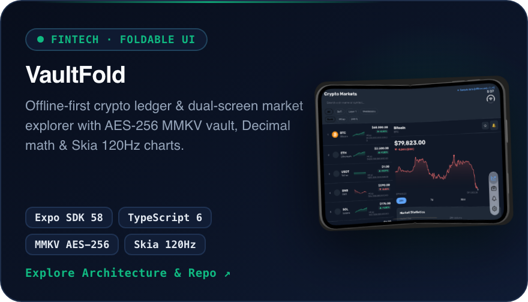</picture></a>
  <a href="https://github.com/muhammedelnady/react-native-foldface"><picture><source media="(prefers-color-scheme: dark)" srcset="./assets/cards/foldface-dark.png" /><source media="(prefers-color-scheme: light)" srcset="./assets/cards/foldface-light.png" />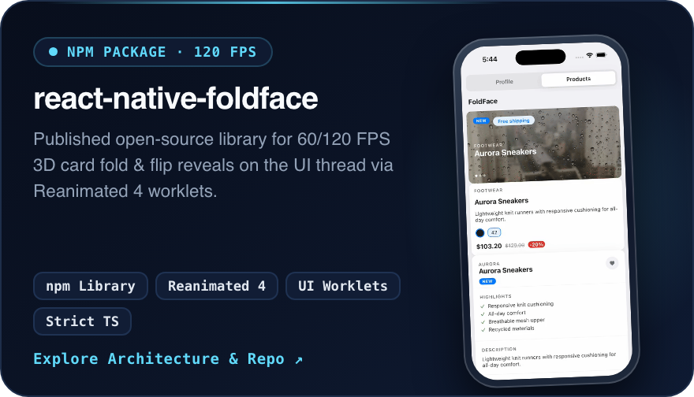</picture></a>

  <a href="https://github.com/muhammedelnady/qadaa"><picture><source media="(prefers-color-scheme: dark)" srcset="./assets/cards/qadaa-dark.png" /><source media="(prefers-color-scheme: light)" srcset="./assets/cards/qadaa-light.png" />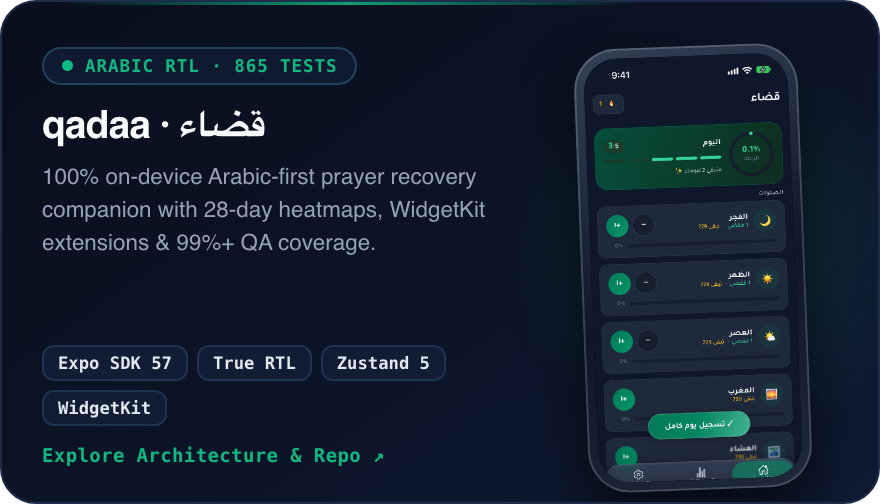</picture></a>
  <a href="https://github.com/muhammedelnady/chat-roulette"><picture><source media="(prefers-color-scheme: dark)" srcset="./assets/cards/chat-roulette-dark.png" /><source media="(prefers-color-scheme: light)" srcset="./assets/cards/chat-roulette-light.png" />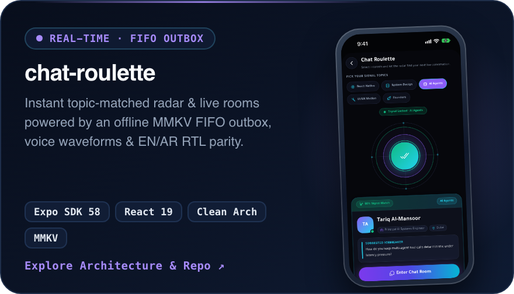</picture></a>

  <a href="https://github.com/muhammedelnady/moviesapp-ios"><picture><source media="(prefers-color-scheme: dark)" srcset="./assets/cards/moviesapp-ios-dark.png" /><source media="(prefers-color-scheme: light)" srcset="./assets/cards/moviesapp-ios-light.png" />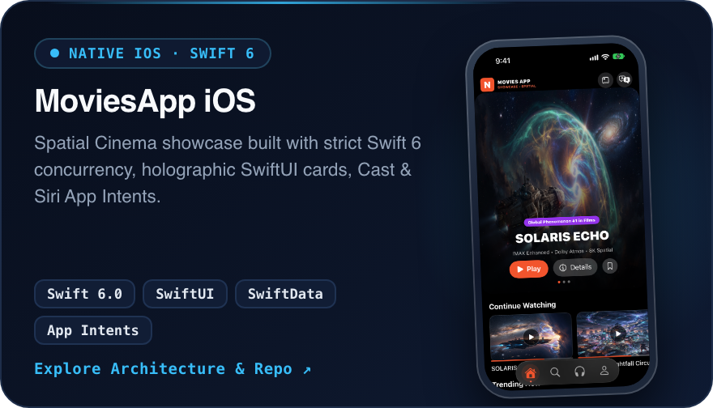</picture></a>
  <a href="https://github.com/muhammedelnady/moviesapp-android"><picture><source media="(prefers-color-scheme: dark)" srcset="./assets/cards/moviesapp-android-dark.png" /><source media="(prefers-color-scheme: light)" srcset="./assets/cards/moviesapp-android-light.png" />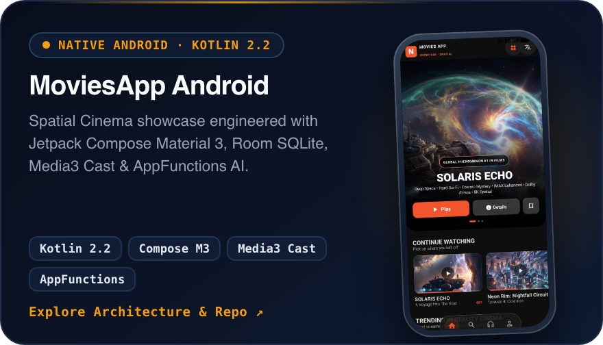</picture></a>

<!-- 4. Commercial Enterprise Multi-Tenant Suite -->

  <picture>
    <source media="(prefers-color-scheme: dark)" srcset="./assets/enterprise-dark.svg" />
    <source media="(prefers-color-scheme: light)" srcset="./assets/enterprise-light.svg" />
    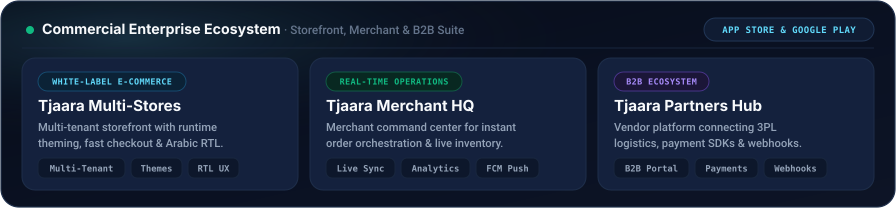
  </picture>

 

<!-- 5. System Architecture & Core Stack -->
<h3 align="center">System Architecture &amp; Production Stack</h3>

  <picture>
    <source media="(prefers-color-scheme: dark)" srcset="./assets/architecture-dark.svg" />
    <source media="(prefers-color-scheme: light)" srcset="./assets/architecture-light.svg" />
    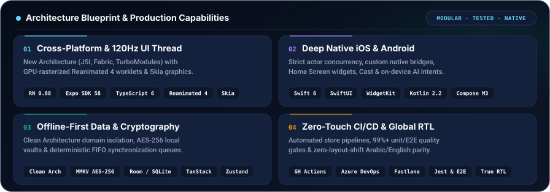
  </picture>

  <picture>
    <source media="(prefers-color-scheme: dark)" srcset="./assets/marquee-dark.svg" />
    <source media="(prefers-color-scheme: light)" srcset="./assets/marquee-light.svg" />
    
  </picture>

 

<!-- 6. Self-Hosted GitHub Telemetry, Velocity & Contribution Snake -->
<h3 align="center">Engineering Telemetry &amp; Activity</h3>

  <picture><source media="(prefers-color-scheme: dark)" srcset="./assets/stats-dark.svg" /><source media="(prefers-color-scheme: light)" srcset="./assets/stats-light.svg" /></picture>
  <picture><source media="(prefers-color-scheme: dark)" srcset="./assets/languages-dark.svg" /><source media="(prefers-color-scheme: light)" srcset="./assets/languages-light.svg" />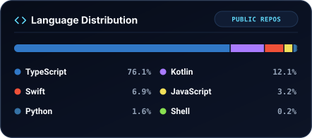</picture>

  <picture>
    <source media="(prefers-color-scheme: dark)" srcset="./assets/stats-velocity-dark.svg" />
    <source media="(prefers-color-scheme: light)" srcset="./assets/stats-velocity-light.svg" />
    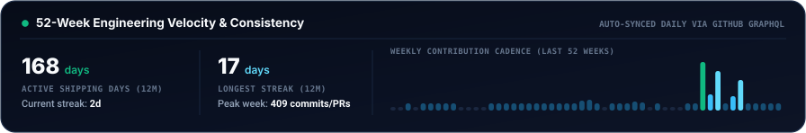
  </picture>

  <picture>
    <source media="(prefers-color-scheme: dark)" srcset="https://raw.githubusercontent.com/muhammedelnady/muhammedelnady/output/github-snake-dark.svg" />
    <source media="(prefers-color-scheme: light)" srcset="https://raw.githubusercontent.com/muhammedelnady/muhammedelnady/output/github-snake.svg" />
    
  </picture>

 

<!-- 7. Executive Sign-Off Footer -->
<a href="mailto:muhammed.elnady@hotmail.com">
  <picture>
    <source media="(prefers-color-scheme: dark)" srcset="./footer.svg" />
    <source media="(prefers-color-scheme: light)" srcset="./assets/footer-light.svg" />
    
  </picture>
</a>

