<!--
  Mohamed Elnady · GitHub Profile README
  Adaptive Dark/Light Design System · React Cyan #61DAFB / #087EA4 · Electric Blue #0A66C2 · Emerald #10B981
-->

<div align="center">

<!-- Adaptive Hero Banner -->
<a href="https://mohamedelnady.vercel.app/">
  <picture>
    <source media="(prefers-color-scheme: dark)" srcset="./banner.svg" />
    <source media="(prefers-color-scheme: light)" srcset="./assets/banner-light.svg" />
    
  </picture>
</a>

<!-- Adaptive Typing Sub-Hero -->
<a href="https://mohamedelnady.vercel.app/">
  <picture>
    <source media="(prefers-color-scheme: dark)" srcset="https://readme-typing-svg.demolab.com?font=Fira+Code&weight=600&size=21&duration=2800&pause=1000&color=61DAFB&center=true&vCenter=true&width=840&height=42&lines=Architecting+60FPS+Cross-Platform+Apps+That+Feel+100%25+Native;8%2B+Years+Engineering+Production+Mobile+Ecosystems;Deep+Native+Modules+in+Swift%2C+Objective-C%2C+Kotlin+%26+Java;15%2B+High-Scale+Apps+Live+on+the+App+Store+%26+Google+Play" />
    <source media="(prefers-color-scheme: light)" srcset="https://readme-typing-svg.demolab.com?font=Fira+Code&weight=600&size=21&duration=2800&pause=1000&color=087EA4&center=true&vCenter=true&width=840&height=42&lines=Architecting+60FPS+Cross-Platform+Apps+That+Feel+100%25+Native;8%2B+Years+Engineering+Production+Mobile+Ecosystems;Deep+Native+Modules+in+Swift%2C+Objective-C%2C+Kotlin+%26+Java;15%2B+High-Scale+Apps+Live+on+the+App+Store+%26+Google+Play" />
    
  </picture>
</a>

<!-- Unified Command Bar -->
<p>
  <a href="https://mohamedelnady.vercel.app/"></a>&nbsp;
  <a href="https://linkedin.com/in/mohammedelnady"></a>&nbsp;
  <a href="mailto:muhammed.elnady@hotmail.com"></a>&nbsp;
  <a href="https://github.com/muhammedelnady"></a>&nbsp;
  
</p>

<p><sub><b>Open to Senior / Staff Mobile Architect Roles</b> &nbsp;·&nbsp; Cairo, Egypt &nbsp;·&nbsp; Remote Worldwide</sub></p>

</div>

---

<h2 align="center">Engineering DNA</h2>

```ts
const mohamedElnady = {
  role: "Senior React Native & Mobile Product Architect",
  experience: "8+ Years · 15+ Production Apps on App Store & Google Play",
  domains: ["Multi-Tenant E-Commerce", "PropTech & Real Estate", "On-Demand Logistics"],

  architecturePillars: {
    crossPlatform: ["React Native (New Architecture)", "Expo SDK", "TypeScript", "JSI / TurboModules"],
    nativeBridge:  ["iOS (Swift / Objective-C)", "Android (Kotlin / Java)", "Custom Native SDKs"],
    dataAndState:  ["Clean Architecture", "Offline-First Sync", "MMKV / SQLite", "TanStack Query", "Redux Toolkit"],
    localization:  ["Zero-Layout-Shift RTL", "Arabic UX Parity", "Dynamic Multi-Tenant Theming"],
    devSecOps:     ["Azure DevOps Pipelines", "GitHub Actions", "Fastlane", "Jest & Detox E2E"],
  },

  philosophy: "Ship fast. Feel native. Scale clean.",
} as const;
```

---

<h2 align="center">Tech Stack &amp; Production Capabilities</h2>

<div align="center">

<table width="100%">
  <thead>
    <tr>
      <th align="left" width="24%">Layer</th>
      <th align="center" width="26%">Core Stack</th>
      <th align="left" width="50%">Production Capabilities</th>
    </tr>
  </thead>
  <tbody>
    <tr>
      <td><b>Cross-Platform Core</b></td>
      <td align="center">
        <picture>
          <source media="(prefers-color-scheme: dark)" srcset="https://skillicons.dev/icons?i=react,ts,js&perline=3&theme=dark" />
          <source media="(prefers-color-scheme: light)" srcset="https://skillicons.dev/icons?i=react,ts,js&perline=3&theme=light" />
          
        </picture>
      </td>
      <td><code>React Native</code> <code>Expo SDK</code> <code>Fabric / JSI</code> <code>Reanimated 60/120 FPS</code></td>
    </tr>
    <tr>
      <td><b>Native iOS &amp; Android</b></td>
      <td align="center">
        <picture>
          <source media="(prefers-color-scheme: dark)" srcset="https://skillicons.dev/icons?i=swift,kotlin,apple,androidstudio&perline=4&theme=dark" />
          <source media="(prefers-color-scheme: light)" srcset="https://skillicons.dev/icons?i=swift,kotlin,apple,androidstudio&perline=4&theme=light" />
          
        </picture>
      </td>
      <td><code>Swift</code> <code>Objective-C</code> <code>Kotlin</code> <code>Java</code> <code>Native Bridges</code> <code>Background Services</code></td>
    </tr>
    <tr>
      <td><b>State &amp; Offline Data</b></td>
      <td align="center">
        <picture>
          <source media="(prefers-color-scheme: dark)" srcset="https://skillicons.dev/icons?i=redux,graphql,sqlite&perline=3&theme=dark" />
          <source media="(prefers-color-scheme: light)" srcset="https://skillicons.dev/icons?i=redux,graphql,sqlite&perline=3&theme=light" />
          
        </picture>
      </td>
      <td><code>Redux Toolkit</code> <code>TanStack Query</code> <code>Zustand</code> <code>MMKV</code> <code>Offline-First Queues</code></td>
    </tr>
    <tr>
      <td><b>Cloud &amp; Backend</b></td>
      <td align="center">
        <picture>
          <source media="(prefers-color-scheme: dark)" srcset="https://skillicons.dev/icons?i=firebase,nodejs,docker&perline=3&theme=dark" />
          <source media="(prefers-color-scheme: light)" srcset="https://skillicons.dev/icons?i=firebase,nodejs,docker&perline=3&theme=light" />
          
        </picture>
      </td>
      <td><code>Firebase Suite</code> <code>Firestore Live Sync</code> <code>FCM Push Engine</code> <code>Deep Linking</code></td>
    </tr>
    <tr>
      <td><b>CI/CD &amp; Quality Gates</b></td>
      <td align="center">
        <picture>
          <source media="(prefers-color-scheme: dark)" srcset="https://skillicons.dev/icons?i=azure,githubactions,jest,git&perline=4&theme=dark" />
          <source media="(prefers-color-scheme: light)" srcset="https://skillicons.dev/icons?i=azure,githubactions,jest,git&perline=4&theme=light" />
          
        </picture>
      </td>
      <td><code>Azure DevOps</code> <code>GitHub Actions</code> <code>Fastlane Releases</code> <code>Jest</code> <code>Detox E2E</code></td>
    </tr>
    <tr>
      <td><b>Design &amp; Build Tooling</b></td>
      <td align="center">
        <picture>
          <source media="(prefers-color-scheme: dark)" srcset="https://skillicons.dev/icons?i=figma,vscode,gradle,sentry&perline=4&theme=dark" />
          <source media="(prefers-color-scheme: light)" srcset="https://skillicons.dev/icons?i=figma,vscode,gradle,sentry&perline=4&theme=light" />
          
        </picture>
      </td>
      <td><code>Multi-Tenant White-Labeling</code> <code>Dynamic Theme Engine</code> <code>Native Arabic RTL &amp; i18n</code> <code>Sentry Telemetry</code></td>
    </tr>
  </tbody>
</table>

</div>

---

<h2 align="center">Selected Work — Enterprise &amp; Open-Source</h2>

<div align="center">

<table width="100%">
  <tr>
    <td align="center" width="33%" valign="top">
      <h3>Tjaara Multi-Stores</h3>
      
      <p align="center">
        Multi-tenant e-commerce flagship featuring a real-time dynamic theming engine, high-conversion checkout flows, and native-grade Arabic RTL UX.
      </p>
      <p>
        <code>Multi-Tenant</code> <code>Dynamic Theme</code> <code>RTL Engine</code>
      </p>
    </td>
    <td align="center" width="33%" valign="top">
      <h3>Tjaara Merchant HQ</h3>
      
      <p align="center">
        Mission-critical merchant command center delivering instant order orchestration, live inventory synchronization, and interactive analytics.
      </p>
      <p>
        <code>Live Sync</code> <code>Analytics HUD</code> <code>Push Alerts</code>
      </p>
    </td>
    <td align="center" width="33%" valign="top">
      <h3>Tjaara Partners Hub</h3>
      
      <p align="center">
        Extensible B2B integration platform connecting merchants, third-party logistics, payment gateways, and automated vendor workflows.
      </p>
      <p>
        <code>B2B Portal</code> <code>API Gateway</code> <code>Webhooks</code>
      </p>
    </td>
  </tr>
</table>

<table width="100%">
  <tr>
    <td width="50%" valign="top">
      <h4><a href="https://github.com/muhammedelnady/VaultFold">VaultFold</a></h4>
      <p>Offline-first, privacy-preserving crypto portfolio ledger &amp; market explorer with AES-256 MMKV vault, arbitrary-precision Decimal math, Skia 120Hz charts, and adaptive foldable postures.</p>
      <p><code>Expo SDK 58</code> <code>TypeScript 6</code> <code>MMKV AES-256</code> <code>Skia</code> <code>Foldable UI</code></p>
    </td>
    <td width="50%" valign="top">
      <h4><a href="https://github.com/muhammedelnady/chat-roulette">chat-roulette</a></h4>
      <p>Real-time messaging rooms &amp; topic-matched roulette radar showcase featuring an offline-first MMKV FIFO outbox, voice note waveforms, emoji reactions, and live EN/AR RTL switching.</p>
      <p><code>Expo SDK 58</code> <code>React 19</code> <code>Clean Architecture</code> <code>Reanimated 4</code> <code>Argent E2E</code></p>
    </td>
  </tr>
  <tr>
    <td width="50%" valign="top">
      <h4><a href="https://github.com/muhammedelnady/qadaa">qadaa (قضاء)</a></h4>
      <p>Arabic-first, 100% on-device prayer recovery companion with guided estimation, 28-day consistency heatmaps, streaks &amp; ranks, native Home Screen widgets, and 865 passing tests (99%+ coverage).</p>
      <p><code>Expo SDK 57</code> <code>Arabic RTL</code> <code>Zustand 5</code> <code>WidgetKit</code> <code>99% Coverage</code></p>
    </td>
    <td width="50%" valign="top">
      <h4><a href="https://github.com/muhammedelnady/react-native-foldface">react-native-foldface</a></h4>
      <p>Published open-source npm library delivering 60/120 FPS 3D card fold &amp; flip reveal animations on the UI thread via Reanimated 4 worklets, hardware rasterization, and nested fold cascades.</p>
      <p><code>npm Package</code> <code>Reanimated 4</code> <code>Worklets</code> <code>TypeScript</code> <code>Tree-Shakeable</code></p>
    </td>
  </tr>
  <tr>
    <td width="50%" valign="top">
      <h4><a href="https://github.com/muhammedelnady/moviesapp-ios">moviesapp-ios</a></h4>
      <p>Native iOS Spatial Cinema showcase built with strict Swift 6 concurrency, holographic discovery cards, 360° Atmos player, multi-size WidgetKit extensions, Google Cast, and Siri App Intents.</p>
      <p><code>Swift 6.0</code> <code>SwiftUI</code> <code>SwiftData</code> <code>WidgetKit</code> <code>App Intents</code></p>
    </td>
    <td width="50%" valign="top">
      <h4><a href="https://github.com/muhammedelnady/moviesapp-android">moviesapp-android</a></h4>
      <p>Native Android Spatial Cinema showcase built with Kotlin 2.2, Jetpack Compose Material 3, Room SQLite, Media3 ExoPlayer &amp; Google Cast, 3 Home Screen widgets, and Android AppFunctions AI.</p>
      <p><code>Kotlin 2.2</code> <code>Jetpack Compose</code> <code>Material 3</code> <code>Media3 Cast</code> <code>AppFunctions</code></p>
    </td>
  </tr>
</table>

</div>

<details>
  <summary><b>Architecture Deep Dive: How I Build High-Scale Mobile Systems</b></summary>
  <br/>
  <table width="100%">
    <tr>
      <td width="50%" valign="top">
        <h4>Clean Modular Architecture</h4>
        <ul>
          <li>Strict separation between <b>Presentation</b>, <b>Domain Use-Cases</b>, and <b>Data Repositories</b>.</li>
          <li>Zero-coupling feature modules enabling parallel team velocity and instant white-label builds.</li>
        </ul>
      </td>
      <td width="50%" valign="top">
        <h4>60 / 120 FPS Native-Grade Performance</h4>
        <ul>
          <li>Offloading heavy computations &amp; animations to the Native UI Thread via <b>JSI &amp; Reanimated</b>.</li>
          <li>Optimistic UI updates paired with resilient offline queue synchronization.</li>
        </ul>
      </td>
    </tr>
    <tr>
      <td width="50%" valign="top">
        <h4>True Arabic RTL &amp; Multi-Tenant Engine</h4>
        <ul>
          <li>Runtime theme injection, custom typography scaling, and bidirectional layout parity.</li>
          <li>Automated multi-brand provisioning from a single unified codebase.</li>
        </ul>
      </td>
      <td width="50%" valign="top">
        <h4>Zero-Touch CI/CD Release Pipelines</h4>
        <ul>
          <li>Automated code-signing, environment matrix builds, and staged rollouts via <b>Azure DevOps &amp; GitHub Actions</b>.</li>
          <li>Pre-release quality gates powered by <b>Jest</b> unit suites and <b>Detox E2E</b> automation.</li>
        </ul>
      </td>
    </tr>
  </table>
</details>

---

<h2 align="center">GitHub Telemetry &amp; Activity</h2>

<div align="center">

<!-- Live Self-Hosted Telemetry & Language Cards (Auto-Updated via GitHub Actions) -->
<table width="100%">
  <tr>
    <td width="50%" align="center">
      <picture>
        <source media="(prefers-color-scheme: dark)" srcset="./assets/stats-dark.svg" />
        <source media="(prefers-color-scheme: light)" srcset="./assets/stats-light.svg" />
        
      </picture>
    </td>
    <td width="50%" align="center">
      <picture>
        <source media="(prefers-color-scheme: dark)" srcset="./assets/languages-dark.svg" />
        <source media="(prefers-color-scheme: light)" srcset="./assets/languages-light.svg" />
        
      </picture>
    </td>
  </tr>
</table>

<!-- Adaptive Contribution Streak -->
<p align="center">
  <picture>
    <source media="(prefers-color-scheme: dark)" srcset="https://streak-stats.demolab.com/?user=muhammedelnady&theme=tokyonight&hide_border=false&border=24344D&border_radius=14&ring=61DAFB&fire=61DAFB&currStreakLabel=61DAFB&background=0D1117" />
    <source media="(prefers-color-scheme: light)" srcset="https://streak-stats.demolab.com/?user=muhammedelnady&theme=default&hide_border=false&border=CBD5E1&border_radius=14&ring=087EA4&fire=087EA4&currStreakLabel=087EA4&sideNums=0F172A&currStreakNum=0F172A&sideLabels=475569&dates=64748B&stroke=E2E8F0&background=F8FAFC" />
    
  </picture>
</p>

<!-- Adaptive Contribution Snake -->
<p align="center">
  <picture>
    <source media="(prefers-color-scheme: dark)" srcset="https://raw.githubusercontent.com/muhammedelnady/muhammedelnady/output/github-snake-dark.svg" />
    <source media="(prefers-color-scheme: light)" srcset="https://raw.githubusercontent.com/muhammedelnady/muhammedelnady/output/github-snake.svg" />
    
  </picture>
</p>

</div>

---

<h2 align="center">Let's Build Something Extraordinary</h2>

<div align="center">

*Whether you are launching a flagship mobile product, modernizing a complex native codebase, or automating your release pipeline — let's make it happen.*

<table width="100%">
  <tr>
    <td align="center" width="33%">
      <h4>Green-Field Mobile Products</h4>
      <sub>From 0 to App Store &amp; Google Play with rock-solid scalable foundations</sub>
    </td>
    <td align="center" width="33%">
      <h4>Architecture &amp; Performance</h4>
      <sub>Refactoring bottlenecks into clean, maintainable, 60/120 FPS architecture</sub>
    </td>
    <td align="center" width="33%">
      <h4>CI/CD &amp; Release Automation</h4>
      <sub>Cutting release cycles from days to minutes with automated store pipelines</sub>
    </td>
  </tr>
</table>

<p>
  <a href="https://mohamedelnady.vercel.app/"><b>Portfolio</b> · mohamedelnady.vercel.app</a>
  &nbsp;&nbsp;|&nbsp;&nbsp;
  <a href="https://linkedin.com/in/mohammedelnady"><b>LinkedIn</b> · /in/mohammedelnady</a>
  &nbsp;&nbsp;|&nbsp;&nbsp;
  <a href="mailto:muhammed.elnady@hotmail.com"><b>Email</b> · muhammed.elnady@hotmail.com</a>
</p>

<br/>

<!-- Adaptive Footer Card -->
<picture>
  <source media="(prefers-color-scheme: dark)" srcset="./footer.svg" />
  <source media="(prefers-color-scheme: light)" srcset="./assets/footer-light.svg" />
  
</picture>

</div>
