<!--
  ✨ Mohamed Elnady · GitHub profile README
  Palette: React cyan #61DAFB · deep blue #0A66C2 · GitHub dark #0D1117
  Tip: search-and-replace these hex codes to re-theme the whole page.
-->

<div align="center">

<!-- 🌊 Animated wave banner -->


<!-- ⌨️ Typing animation (switches colour automatically in light / dark mode) -->
<a href="https://mohamedelnady.vercel.app/">
  <picture>
    <source media="(prefers-color-scheme: dark)" srcset="https://readme-typing-svg.demolab.com?font=Fira+Code&weight=600&size=24&duration=3000&pause=1000&color=61DAFB&center=true&vCenter=true&width=800&height=50&lines=Hi+there!+I%27m+Mohamed+%F0%9F%91%8B;8%2B+years+shipping+mobile+apps+that+scale+%F0%9F%9A%80;Bridging+React+Native%2C+Swift+%26+Kotlin+%F0%9F%8C%89;15%2B+apps+live+on+the+App+Store+%26+Google+Play+%F0%9F%93%B1">
    <source media="(prefers-color-scheme: light)" srcset="https://readme-typing-svg.demolab.com?font=Fira+Code&weight=600&size=24&duration=3000&pause=1000&color=087EA4&center=true&vCenter=true&width=800&height=50&lines=Hi+there!+I%27m+Mohamed+%F0%9F%91%8B;8%2B+years+shipping+mobile+apps+that+scale+%F0%9F%9A%80;Bridging+React+Native%2C+Swift+%26+Kotlin+%F0%9F%8C%89;15%2B+apps+live+on+the+App+Store+%26+Google+Play+%F0%9F%93%B1">
    
  </picture>
</a>

<p>
  <b>I build mobile apps that feel native, scale cleanly and ship reliably.</b><br/>
  Engineering high-performance cross-platform products across
  <b>E-commerce</b>, <b>Real Estate</b> &amp; <b>On-Demand</b> ecosystems.
</p>

<!-- 🔗 Quick links -->
<p>
  <a href="https://mohamedelnady.vercel.app/"></a>
  <a href="https://linkedin.com/in/mohammedelnady"></a>
  <a href="mailto:muhammed.elnady@hotmail.com"></a>
  
</p>

<!-- 📈 By the numbers -->
<table align="center">
  <tr>
    <td align="center"><h3>8+</h3><sub>YEARS OF EXPERIENCE</sub></td>
    <td align="center"><h3>15+</h3><sub>APPS IN PRODUCTION</sub></td>
    <td align="center"><h3>4</h3><sub>NATIVE LANGUAGES</sub></td>
    <td align="center"><h3>3</h3><sub>INDUSTRIES</sub></td>
  </tr>
</table>

</div>

<h2 align="center">👨‍💻 About Me</h2>

```ts
const mohamed = {
  role: "Senior React Native & Mobile Engineer",
  experience: "8+ years",
  shipped: "15+ production apps on the App Store & Google Play",
  industries: ["E-commerce", "Real Estate", "On-Demand"],

  superpowers: [
    "React Native & Expo, with deep native modules in Swift, Obj-C, Kotlin & Java",
    "Clean Architecture & offline-first synchronization",
    "RTL, Arabic localization & multi-tenant theming",
    "CI/CD automation with Azure DevOps & GitHub Actions",
    "Unit & E2E testing with Jest & Detox",
  ],

  helpsWith: [
    "Building high-performance cross-platform apps",
    "Refactoring legacy codebases into modern clean architecture",
    "Optimizing CI/CD release pipelines",
  ],

  motto: "Ship fast. Feel native. Scale clean.",
} as const;
```

<h2 align="center">🧰 Tech Arsenal</h2>

<div align="center">

| Domain | Technologies |
| :--- | :--- |
| **📱 Mobile Core** | <br/>`React Native` `Expo` |
| **🧬 Native Bridge** | <br/>`Objective-C` `iOS SDK` `Android SDK` `Native Modules` |
| **🧠 State & Data** | <br/>`Redux Toolkit` `React Query` `Zustand` `REST APIs` |
| **☁️ Cloud & Backend** | <br/>`Firestore` `FCM Push Notifications` |
| **🚦 CI/CD & Testing** | <br/>`Azure DevOps` `Detox E2E` |
| **🎨 UI/UX & Tooling** | <br/>`RTL & i18n` `Multi-tenant Theming` |

</div>

<h2 align="center">🏆 Flagship Production Platforms</h2>

<div align="center">

| 🛍️ **Tjaara Multi-Stores App** | 📊 **Tjaara Dashboard App** | 🤝 **Tjaara Partners App** |
| :---: | :---: | :---: |
| Multi-tenant e-commerce with a dynamic theming engine and full RTL Arabic UX | Real-time merchant operations, live inventory sync & analytics visualization | Extensible integration hub connecting merchants, APIs & third-party vendors |
| `Multi-tenant` `Theming` `RTL` | `Real-time` `Inventory` `Analytics` | `Integrations` `APIs` `Vendors` |

</div>

<h2 align="center">📊 GitHub Stats</h2>

<div align="center">
  
  <br/><br/>
  
</div>

<h2 align="center">🤝 Let's Build Something Great</h2>

<div align="center">

*Got a product idea, a tangled legacy codebase, or a slow release pipeline? Let's talk.*

| 📱 **Build** | 🏗️ **Refactor** | 🚀 **Ship** |
| :---: | :---: | :---: |
| High-performance cross-platform apps that feel truly native | Legacy codebases → modern clean architecture | Faster, safer releases with optimized CI/CD pipelines |

<p>
  <a href="https://mohamedelnady.vercel.app/"></a>
  <a href="https://linkedin.com/in/mohammedelnady"></a>
  <a href="mailto:muhammed.elnady@hotmail.com"></a>
</p>

<sub>Thanks for stopping by. Let's ship something great. ⚡</sub>



</div>
